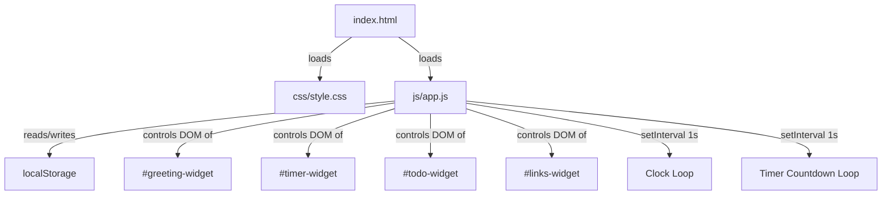

# Design Document

## Overview

Life Dashboard adalah aplikasi web personal berbasis browser yang berjalan sepenuhnya di sisi klien. Tidak ada backend, tidak ada build tools, dan tidak ada dependensi eksternal — hanya tiga file: `index.html`, `css/style.css`, dan `js/app.js`. Semua data disimpan melalui `localStorage`.

Dashboard menampilkan empat widget secara bersamaan dalam satu halaman:

1. **Greeting Widget** — Jam real-time, tanggal, dan salam berdasarkan waktu hari.
2. **Focus Timer Widget** — Timer Pomodoro 25 menit dengan kontrol Start/Stop/Reset.
3. **To-Do List Widget** — CRUD task lengkap dengan persistensi ke localStorage.
4. **Quick Links Widget** — Simpan dan buka tautan favorit di tab baru.

Karena proyek ini adalah pure Vanilla JS tanpa modul bundler, seluruh kode widget ditulis dalam satu file `app.js` yang terstruktur menggunakan object literal sebagai namespace widget. Tidak ada import/export — fungsi-fungsi diorganisir dalam blok `const WidgetName = { ... }` agar mudah dibaca dan dikelola.

---

## Architecture

Aplikasi menggunakan arsitektur **single-page, client-side only** dengan pola **direct DOM manipulation** tanpa virtual DOM atau reactive framework.



**Prinsip desain utama:**

- **Separation by widget namespace**: Setiap widget punya object literal sendiri (`GreetingWidget`, `TimerWidget`, `TodoWidget`, `LinksWidget`) dengan method `init()`, `render()`, dan fungsi-fungsi spesifik.
- **Single source of truth**: State di-simpan dalam variabel modul (`let tasks = []`, `let links = []`, `let timerState = {}`) dan di-sync ke localStorage setiap kali berubah.
- **Event delegation**: Event listener dipasang pada container widget, bukan pada setiap item, untuk efisiensi pada daftar panjang.
- **Graceful degradation**: Setiap widget dibungkus `try/catch` sehingga kegagalan satu widget tidak merusak widget lain.

---

## Components and Interfaces

### 1. Greeting Widget (`GreetingWidget`)

**Tanggung jawab**: Menampilkan jam lokal, tanggal, dan salam berdasarkan jam.

```
GreetingWidget
├── init()              → query DOM elements, start clock loop
├── tick()              → update time, date, greeting setiap detik
├── formatTime(date)    → return "HH:MM:SS"
├── formatDate(date)    → return "Senin, 3 November 2025"
└── getGreeting(hour)   → return "Selamat Pagi/Siang/Sore/Malam"
```

**DOM elements yang digunakan:**
- `#greeting-time` — menampilkan waktu HH:MM:SS
- `#greeting-date` — menampilkan tanggal panjang
- `#greeting-text` — menampilkan teks salam

**Clock loop**: `setInterval(() => GreetingWidget.tick(), 1000)` dipanggil sekali saat `init()`. Tidak ada cleanup yang diperlukan karena widget hidup selama halaman hidup.

---

### 2. Focus Timer Widget (`TimerWidget`)

**Tanggung jawab**: Timer hitung mundur 25 menit dengan kontrol Start/Stop/Reset dan notifikasi saat selesai.

```
TimerWidget
├── init()              → query DOM, pasang event listeners, render awal
├── start()             → mulai setInterval countdown jika belum running
├── stop()              → clearInterval, pertahankan sisa waktu
├── reset()             → clearInterval, set remaining = 25*60, render
├── tick()              → kurangi remaining 1 detik, cek selesai
├── onComplete()        → tampilkan indikator, kirim notif jika diizinkan
├── render()            → update #timer-display dengan MM:SS
└── formatTime(seconds) → return "MM:SS"
```

**State internal:**
```js
let timerState = {
  remaining: 25 * 60,  // detik
  running: false,
  intervalId: null
};
```

**DOM elements:**
- `#timer-display` — "25:00", diperbarui setiap detik
- `#timer-btn-start` — tombol Start
- `#timer-btn-stop` — tombol Stop
- `#timer-btn-reset` — tombol Reset
- `#timer-complete-msg` — pesan/indikator sesi selesai (hidden by default)

**Notifikasi**: Saat `onComplete()`, cek `'Notification' in window`. Jika ya dan `Notification.permission === 'granted'`, kirim `new Notification(...)`. Jika tidak, tampilkan fallback di `#timer-complete-msg`.

---

### 3. To-Do List Widget (`TodoWidget`)

**Tanggung jawab**: CRUD task dengan persistensi localStorage.

```
TodoWidget
├── init()              → load dari storage, render, pasang event listeners
├── loadFromStorage()   → return array Task dari localStorage (atau [])
├── saveToStorage()     → JSON.stringify tasks ke localStorage
├── render()            → rebuild seluruh daftar task di DOM
├── addTask(text)       → validasi, tambah task baru, save, render
├── editTask(id, text)  → validasi, update teks, save, render
├── toggleTask(id)      → toggle done, save, render
├── deleteTask(id)      → hapus dari array, save, render
├── showEditInput(id)   → tampilkan edit field pada baris task
├── hideEditInput(id)   → sembunyikan edit field, restore tampilan
└── handleEvent(e)      → event delegation untuk semua klik di dalam widget
```

**DOM elements:**
- `#todo-input` — input field tambah task
- `#todo-add-btn` — tombol tambah
- `#todo-list` — container `<ul>` untuk item task

**Event delegation**: Satu listener `click` pada `#todo-list` menangani semua aksi tombol (edit, batal, konfirmasi edit, hapus, toggle selesai) menggunakan `data-action` dan `data-id` attributes.

---

### 4. Quick Links Widget (`LinksWidget`)

**Tanggung jawab**: Simpan, tampilkan, dan hapus tautan, buka di tab baru.

```
LinksWidget
├── init()              → load dari storage, render, pasang event listeners
├── loadFromStorage()   → return array Link dari localStorage (atau [])
├── saveToStorage()     → JSON.stringify links ke localStorage
├── render()            → rebuild daftar link di DOM
├── addLink(label, url) → validasi, tambah link baru, save, render
├── deleteLink(id)      → hapus dari array, save, render
├── validateUrl(url)    → return true jika dimulai http:// atau https://
├── validateLabel(lbl)  → return true jika 1–50 karakter non-spasi
├── showError(msg)      → tampilkan pesan error validasi
└── handleEvent(e)      → event delegation untuk klik hapus
```

**DOM elements:**
- `#links-label-input` — input label
- `#links-url-input` — input URL
- `#links-add-btn` — tombol tambah
- `#links-error-msg` — pesan error validasi
- `#links-list` — container `<ul>` untuk item link

---

## Data Models

Semua data disimpan di `localStorage` menggunakan dua key tetap.

### Task

**localStorage key**: `"life_dashboard_tasks"`

```json
[
  {
    "id": "task_1699001234567",
    "text": "Belajar CSS Grid",
    "done": false
  },
  {
    "id": "task_1699001299999",
    "text": "Review PR teman",
    "done": true
  }
]
```

| Field | Tipe     | Keterangan                                          |
|-------|----------|-----------------------------------------------------|
| `id`  | `string` | Unique ID: `"task_" + Date.now()` saat task dibuat  |
| `text`| `string` | Deskripsi task, tidak boleh kosong atau hanya spasi |
| `done`| `boolean`| `false` = belum selesai, `true` = selesai           |

### Link

**localStorage key**: `"life_dashboard_links"`

```json
[
  {
    "id": "link_1699001234567",
    "label": "RevoU",
    "url": "https://revou.co"
  }
]
```

| Field   | Tipe     | Keterangan                                         |
|---------|----------|----------------------------------------------------|
| `id`    | `string` | Unique ID: `"link_" + Date.now()` saat link dibuat |
| `label` | `string` | Nama tampilan, 1–50 karakter, tidak boleh hanya spasi |
| `url`   | `string` | Harus dimulai dengan `http://` atau `https://`     |

### Fungsi Storage Helper

```js
function storageGet(key, fallback) {
  try {
    const raw = localStorage.getItem(key);
    if (raw === null) return fallback;
    return JSON.parse(raw);
  } catch (e) {
    return fallback;  // JSON rusak → fallback ke []
  }
}

function storageSet(key, value) {
  try {
    localStorage.setItem(key, JSON.stringify(value));
    return true;
  } catch (e) {
    return false;  // quota exceeded atau storage tidak tersedia
  }
}
```

---

## Correctness Properties

*A property is a characteristic or behavior that should hold true across all valid executions of a system — essentially, a formal statement about what the system should do. Properties serve as the bridge between human-readable specifications and machine-verifiable correctness guarantees.*

### Property 1: Task round-trip serialization

*For any* array of Task objects dengan field `id`, `text`, dan `done` yang valid, menyimpan array tersebut ke localStorage menggunakan `storageSet` lalu membacanya kembali menggunakan `storageGet` harus menghasilkan array yang secara struktur dan nilai ekuivalen dengan array semula.

**Validates: Requirements 4.11, 6.1, 6.2**

### Property 2: Link round-trip serialization

*For any* array of Link objects dengan field `id`, `label`, dan `url` yang valid, menyimpan array ke localStorage menggunakan `storageSet` lalu membacanya kembali menggunakan `storageGet` harus menghasilkan array yang secara struktur dan nilai ekuivalen dengan array semula.

**Validates: Requirements 5.2, 6.1, 6.3**

### Property 3: storageGet mengembalikan fallback untuk data tidak ada atau rusak

*For any* localStorage key yang tidak ada, atau key yang berisi string yang bukan JSON valid, `storageGet(key, fallback)` harus mengembalikan nilai `fallback` yang diberikan tanpa melempar exception.

**Validates: Requirements 6.4, 6.5, 6.6**

### Property 4: Whitespace task input ditolak

*For any* string yang seluruhnya tersusun dari karakter whitespace (spasi, tab, newline, dan kombinasinya), mencoba menambahkan string tersebut sebagai task TIDAK boleh mengubah panjang daftar — daftar sebelum dan sesudah percobaan harus memiliki jumlah item yang sama.

**Validates: Requirements 4.3**

### Property 5: Edit task dengan input kosong/whitespace mempertahankan teks lama

*For any* task yang sudah ada dengan teks non-kosong, mengonfirmasi edit dengan string whitespace-only TIDAK boleh mengubah field `text` task tersebut — nilai `text` harus tetap identik dengan nilai sebelum edit dipanggil.

**Validates: Requirements 4.6**

### Property 6: Toggle done adalah operasi round-trip

*For any* daftar task yang berisi setidaknya satu task, men-toggle status `done` suatu task dua kali berturut-turut harus mengembalikan task tersebut ke nilai `done` semula — apapun nilai awal `done`-nya.

**Validates: Requirements 4.8, 4.9**

### Property 7: Penambahan dan penghapusan task memelihara invariant panjang daftar

*For any* daftar task yang ada dan teks task yang valid (non-whitespace-only), menambahkan task baru harus menghasilkan daftar dengan panjang tepat `n + 1`; dan untuk setiap task yang ada, menghapusnya harus menghasilkan daftar dengan panjang tepat `n - 1` dan ID tersebut tidak lagi ditemukan dalam daftar.

**Validates: Requirements 4.2, 4.10**

### Property 8: Greeting sesuai dengan seluruh rentang jam dalam sehari

*For any* nilai jam integer dalam rentang 0–23, fungsi `getGreeting(hour)` harus mengembalikan tepat satu string salam yang konsisten dengan pemetaan berikut: 5–11 → "Selamat Pagi", 12–14 → "Selamat Siang", 15–17 → "Selamat Sore", 18–23 dan 0–4 → "Selamat Malam" — dan tidak pernah mengembalikan string di luar keempat nilai tersebut.

**Validates: Requirements 2.3, 2.4, 2.5, 2.6**

### Property 9: Validasi URL dan label menolak semua input tidak valid

*For any* string yang tidak dimulai dengan `http://` atau `https://`, `validateUrl` harus mengembalikan `false`; dan *for any* string yang kosong, hanya berisi whitespace, atau melebihi 50 karakter, `validateLabel` harus mengembalikan `false`. Sebaliknya, string yang memenuhi format yang benar harus menghasilkan `true`.

**Validates: Requirements 5.3**

### Property 10: Penambahan link valid menambah panjang daftar tepat satu

*For any* daftar link yang ada dan kombinasi label valid (1–50 karakter, bukan whitespace-only) dengan URL valid (dimulai `http://` atau `https://`), menambahkan link baru harus menghasilkan daftar dengan panjang tepat `n + 1` dan link baru tersebut dapat ditemukan dalam daftar hasil.

**Validates: Requirements 5.2**

---

## Error Handling

### Strategi Umum

Setiap widget diinisialisasi dalam blok `try/catch` terpisah di dalam fungsi `initDashboard()`:

```js
function initDashboard() {
  const widgets = [
    { name: 'Greeting', fn: () => GreetingWidget.init() },
    { name: 'Timer',    fn: () => TimerWidget.init()    },
    { name: 'Todo',     fn: () => TodoWidget.init()     },
    { name: 'Links',    fn: () => LinksWidget.init()    },
  ];

  widgets.forEach(({ name, fn }) => {
    try {
      fn();
    } catch (e) {
      console.error(`Widget ${name} gagal diinisialisasi:`, e);
      showWidgetError(name);
    }
  });
}
```

`showWidgetError(name)` menambahkan pesan error ke dalam container widget yang gagal (menggunakan selector `#${name.toLowerCase()}-widget`) sehingga widget lain tetap berfungsi.

### localStorage Errors

| Skenario | Penanganan |
|---|---|
| Key tidak ada | `storageGet` mengembalikan fallback `[]` |
| JSON rusak / tidak valid | `JSON.parse` di-catch, kembalikan `[]` |
| `storageSet` gagal (quota) | Return `false`, tampilkan error di UI widget yang bersangkutan |
| `localStorage` tidak tersedia | `storageGet`/`storageSet` dibungkus `try/catch` |

### Validasi Input

| Widget | Kondisi invalid | Respons |
|---|---|---|
| Todo | Input kosong atau whitespace-only | Tidak tambah task, tidak ubah state |
| Todo edit | Konfirmasi dengan input kosong/whitespace | Batalkan edit, kembalikan teks lama |
| Links | Label kosong/whitespace atau URL bukan http/https | Tampilkan pesan error spesifik di `#links-error-msg` |

### Notifikasi Browser

Saat timer selesai: cek `'Notification' in window`. Jika API tidak tersedia atau permission bukan `'granted'`, tampilkan fallback UI di `#timer-complete-msg`. Tidak ada crash atau silent failure.

---

## Testing Strategy

Karena aplikasi ini adalah pure Vanilla JS yang berjalan langsung di browser tanpa build tools, pengujian menggunakan pendekatan **dual testing**:

### Unit Tests (Property-Based + Example-Based)

Karena tidak ada test runner yang disetup, unit test dapat dijalankan dengan cara:
1. Ekstrak fungsi pure (seperti `getGreeting`, `validateUrl`, `validateLabel`, `formatTime`, `storageGet`/`storageSet`) ke dalam namespace yang dapat diakses dari console.
2. Gunakan library property-based testing **fast-check** (via CDN di file test HTML terpisah: `test/test.html`) untuk menjalankan property tests.
3. Tag setiap property test dengan komentar: `// Feature: life-dashboard, Property N: <teks property>`

**Library**: [fast-check](https://fast-check.dev/) via CDN — tidak memerlukan npm atau bundler.

**Konfigurasi**: Minimum 100 iterasi per property test (default fast-check sudah 100).

**Property tests yang harus diimplementasikan** (berdasarkan Correctness Properties di atas):

| Property | Fungsi yang diuji | Input generator |
|---|---|---|
| P1: Task round-trip | `storageGet` / `storageSet` | Array of random Task objects |
| P2: Link round-trip | `storageGet` / `storageSet` | Array of random Link objects |
| P3: Whitespace task ditolak | `TodoWidget.addTask` | `fc.string()` filter whitespace-only |
| P4: Edit kosong pertahankan teks | `TodoWidget.editTask` | Random task + whitespace string |
| P5: Toggle done round-trip | `TodoWidget.toggleTask` | Random task list + random index |
| P6: Tambah task +1 panjang | `TodoWidget.addTask` | Random list + valid task text |
| P7: Hapus task -1 panjang | `TodoWidget.deleteTask` | Random non-empty list + random ID |
| P8: Greeting sesuai jam | `GreetingWidget.getGreeting` | `fc.integer({ min: 0, max: 23 })` |
| P9: URL validation | `LinksWidget.validateUrl` | `fc.string()` dengan berbagai prefix |
| P10: Tambah link +1 panjang | `LinksWidget.addLink` | Random list + valid label + valid URL |

### Integration / Example-Based Tests

Untuk skenario yang melibatkan DOM dan interaksi pengguna, gunakan pengujian manual terstruktur dengan checklist di `test/manual-test-checklist.md`:

- Dashboard memuat semua 4 widget tanpa error konsol
- Jam berdetik dan salam berganti pada batas waktu yang benar
- Timer hitung mundur dari 25:00 ke 00:00, tampilkan indikator selesai
- Task CRUD: tambah, edit, toggle, hapus — data persists setelah reload
- Link CRUD: tambah, klik (buka tab baru), hapus — data persists setelah reload
- Tampilan responsive pada lebar 320px dan 768px
